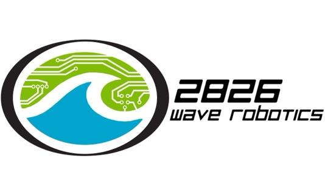
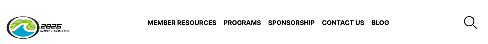
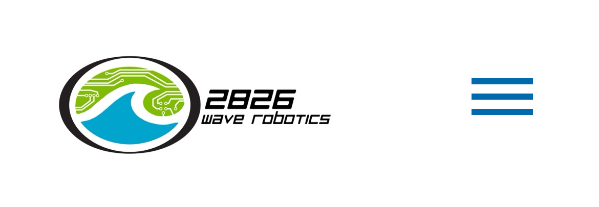

<!-- _class: lead -->
<!-- _paginate: false -->

# waverobotics.com

The website of **Wave Robotics, FIRST team 2826**:
what it does for the team, and what changed in November 2026.

---

## What the site does for the team

### Recruit

Pages for each program (FIRST LEGO League Explore, LEGO League Challenge, FRC), recruitment videos and open-house news.

### Thank sponsors

Sponsor levels from Supporter to Game Changer, with each sponsor's logo and page, and how to become one.

### Tell our story

72 news posts: competitions, robot reveals, awards, outreach, fundraisers and interviews.

### Run the team

Member resources for FLL and FRC families: forms, reimbursement, event paperwork.

### Stay in touch

Contact page, team calendar, training videos, social links.

### Raise money

The Wave Robotics shop and fundraiser announcements.

---

## Same site, any screen

- **Laptop**: menu across the top, search button at the right
- **Phone**: the menu folds into the ☰ button, with a search field inside

The site header on a laptop and on a phone, November 2026.

---

## Who uses it

### Visitors

- Families looking for a program
- Schools and community partners
- Sponsors, current and future
- Team members and parents looking for a form or a date

### Team editors

- Mentors and students write news and update pages **in the browser**
- No coding: pages are built from blocks (text, photos, sliders, videos, grids)
- Changes are live right away for editors, and for visitors within 5 minutes

---

## How it's built

- **Plone**: the content system editors log in to. Open source, used for over 20 years by universities, governments and nonprofits.
- **Volto**: the fast, modern pages visitors see, built on React.
- **One small cloud server** runs both, in Docker containers.
- **Cloudflare** sits in front: it keeps copies of pages and photos close to visitors.
- **GitHub** holds the code. Every change is a reviewed pull request, built and checked automatically before it goes live.

The site's code started from the Plone Conference 2024 website, also built with Plone and Volto.

---

<!-- _class: lead -->

## November 2026

A full upgrade, then a month of fixes, all live with no lost content.

**Plone 6.0 → 6.2.3 · Volto 18 → 19.7**

All 209 public pages were checked before and after every change.

---

## Faster

14.9 s → 4.6 s

Time until the home page's main photo shows, on a phone with a slow 4G connection.

- **About 500 KB less** to download on a first visit: smaller logo, lighter fonts
- The first slider photo loads **first**; others wait their turn
- Videos and calendars load only when you scroll to them
- Pages come from Cloudflare's cache in **about 0.1 s**
- Photos are cached for a year

---

## Easier to use, for everyone

- **Search**: a search button in the header, and a search field in the phone menu
- **Accessibility**: every page checked against WCAG 2.2 (the web accessibility standard); fixed missing image descriptions, low-contrast menus and links that screen readers read out but nobody could see
- **Phones**: the menu, buttons, search page and slider work properly on small screens
- **Fewer surprises for editors**: saving a page no longer breaks slider photos

---

## Safer

- **Nightly backups** of all pages, photos and files, 7 days kept, plus daily backups of the whole server by the hosting company. A restore was tested.
- **Email alerts** when a backup fails or stops running, or the disk fills up
- **Security updates** install automatically every day
- **Up-to-date software**: the Plone and Volto versions still getting fixes

---

## For editors: three habits that help

1. **Describe your photos.** Fill in *Alt text* on image blocks, and the *Description* of photos used in sliders: screen readers read it aloud, and search engines use it.
2. **Give embedded videos and calendars a title.** In an HTML block, add `title="…"` to the `<iframe>`, for example `title="Team calendar"`.
3. **Expect up to 5 minutes.** Visitors may see the old version of a page for a few minutes after you save. You always see the new one.

---

## What's next

- **Content fixes** (no coding): titles for the home-page calendar and two YouTube videos, alt text for the shop banner
- **User accounts**: show when each account was created and last used, and let accounts expire, with a warning first
- **Keep up with Plone and Volto** releases, and keep checking every page after each change

Open work is listed in `TODO.md`, finished work in `CHANGELOG.md`.

---

<!-- _class: lead -->
<!-- _paginate: false -->

# Thank you

**waverobotics.com**

Code and history: [github.com/tkimnguyen/waverobotics.com](https://github.com/tkimnguyen/waverobotics.com)
